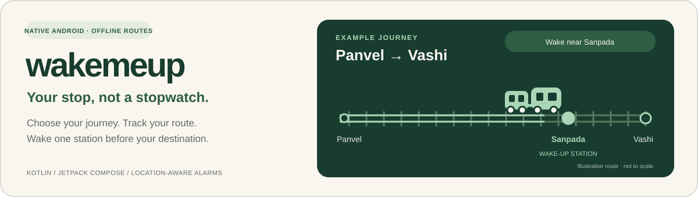
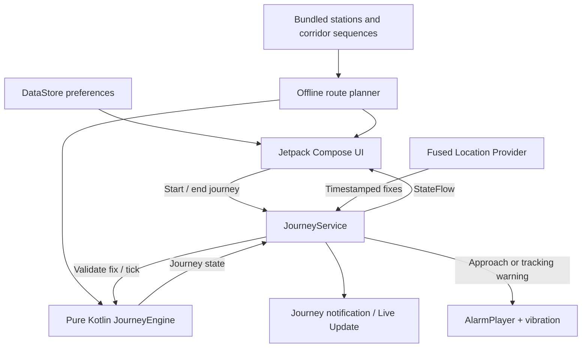

# wakemeup



<p align="center">
  
  
  
  
  
</p>

**A native Android train-journey alarm that uses your location and route to wake you one station before your destination.** Choose where you are travelling, start monitoring, and follow your journey without calculating an alarm time.

**A personal side project, inspired by a real problem I faced on train journeys.** I wanted to rest without repeatedly checking my location or worrying about missing my station, so I started building something I could use myself.

**At a glance:** 142 Mumbai-region stations · 11 corridor variants · custom alarm sounds · light/dark themes · live journey notifications · no account or backend.

**Project status:** working personal MVP, version **0.5.0**. The station-based update has **56 passing local unit tests**. GPS timing, battery behaviour and device-specific notifications still need real-journey testing. This is an assistive alarm, not guaranteed protection against missing a stop.

[Why it exists](#why-it-exists) · [Features](#features) · [How it works](#how-it-works) · [Setup](#setup-and-installation) · [Architecture](#architecture) · [Tests](#testing-and-validation) · [Limitations](#limitations) · [GitHub upload guide](docs/GITHUB_SETUP.md)

## Why it exists

The idea came from my own experience: I wanted to rest on a train, but the worry of missing my station made it difficult to relax. Setting a normal alarm meant guessing the remaining journey time. A train waiting at a signal could make that alarm ring early, while a quicker journey could leave less time to wake up than expected.

I started **wakemeup as a side project for my own use**, focused on that practical problem. The goal is simple: choose the destination once and let location-based monitoring handle the wake-up point, without repeatedly estimating minutes or checking the next station.

wakemeup changes the question from **“What time should I wake up?”** to **“Where should I wake up?”**

For Panvel → Vashi, it identifies **Sanpada** as the preceding station on the selected route and sounds the alarm as you approach it. There is no timetable-based countdown to keep adjusting when the train is delayed.

### Why use this instead of a normal alarm?

| Situation | Fixed-time alarm | wakemeup |
| --- | --- | --- |
| Starting a journey | Estimate the travel time and set a clock time. | Choose source and destination. |
| Train stops or slows down | The alarm time stays unchanged and may ring early. | The station alarm waits for accepted location progress. |
| Journey duration changes | Recalculate or accept an uncertain wake-up time. | The wake-up point stays tied to the route. |
| Preparing to get off | Work out how much time to leave yourself. | Wake near the station before your destination. |
| No mobile internet | A clock alarm still works. | Bundled routes and available device location work without an app data connection. |
| Location becomes unreliable | A clock alarm does not depend on location. | Tracking uncertainty is shown; a live monitoring process can sound a warning. |

The advantage is **less estimation and less timetable dependence**. The trade-off is dependence on location quality and Android allowing the monitoring service to keep running.

## Features

| Feature | Current behaviour |
| --- | --- |
| **Source and destination search** | Search 142 bundled stations by name, code or supported aliases; swap the journey for the return direction. |
| **Wake one station earlier** | Automatically name the preceding station. The old distance selector has been removed. |
| **Route and interchange selection** | Display supported corridor options and train changes; monitor each leg separately. |
| **Offline route data** | Station coordinates and ordered corridors ship with the app. No map key, route-download step or backend is required. |
| **Locked-screen monitoring** | A user-started foreground location service, persistent notification and bounded wake lock support an active journey. |
| **Tracking checks** | Reject stale, inaccurate, off-route and implausible readings; warn about sustained uncertainty and reverse movement. |
| **Custom alarm sounds** | Use the phone default, choose a phone alarm tone or import a playable audio file up to 32 MB. Preview it for five seconds. |
| **Audio and vibration** | Loop the alarm with vibration; fall back through the phone default, bundled sound and generated tone if playback fails. |
| **Minimal interface** | Persistent light/dark theme choice, route details and an animated train that follows confirmed progress. |
| **Journey notifications** | Destination, approximate distance, geographic stations ahead, next station, tracking status and an End journey action. |
| **Android 16 Live Updates** | Request the system progress card and compact status pill on compatible devices; the manufacturer controls promotion and appearance. See [Android's Live Updates guide](https://developer.android.com/develop/ui/views/notifications/live-update). |
| **Local preferences** | Remember the selected journey, sound and theme using DataStore. No sign-in or analytics SDK. |

**Next-station trips:** the preceding station is your source. The app shows a stay-awake warning and sounds an alarm once a trustworthy location is confirmed; it does not promise a useful sleeping interval.

**Train changes:** the wake-up point is the station before the current interchange. Acknowledge the alarm, reach the interchange, board the next train, and explicitly start the next leg.

## How it works

1. **Select the journey.** The offline planner finds corridor paths in travel order, preferring fewer changes and then shorter geographic distance.
2. **Identify the wake-up station.** Use the station immediately before the destination of the current leg.
3. **Start monitoring while the app is visible.** Check permissions, device location, notifications, alarm volume and Do Not Disturb before starting the foreground service.
4. **Validate location updates.** Check freshness and accuracy, project accepted locations onto the route, and detect implausible jumps or reverse movement.
5. **Update confirmed progress.** Move the train and update the notification from trusted progress. Uncertain positions are not extrapolated into a moving train.
6. **Sound the alarm.** Trigger near the wake-up station, or immediately if an accepted reading has already passed it. Acknowledge the alarm to end the leg and release monitoring resources.

An internal **300 m approach allowance**, adjusted by reported location accuracy, helps detect approach to the previous station. This is a fixed implementation detail, not a configurable distance from your destination. Train progress and remaining distance still refer to the actual destination.

### Reliability is part of the design

- Readings older than 20 seconds, with accuracy worse than 150 m, or outside a coarse route corridor are not trusted.
- Jump and sustained reverse-direction checks help detect readings that do not fit the journey.
- Sustained unreliable tracking triggers an audible warning after 60 seconds, or earlier if plausible travel during the signal gap could reach the wake-up point.
- Losing GPS pauses the confirmed train marker. **Offline route data does not mean the app can locate you without usable device signals.** There is no dead reckoning or sensor-fusion position estimate in this version.
- Each leg has a six-hour monitoring budget, followed by a warning. Ending the journey stops location updates, audio and vibration and releases the wake lock.
- An interrupted-session marker warns when the app is reopened after an unexpected stop. Monitoring does not silently restart.

## Supported railway network

The bundled catalogue contains **142 unique stations and 11 corridor variants**:

| Network | Included corridor coverage |
| --- | --- |
| Western | Churchgate ↔ Dahanu Road |
| Central | CSMT ↔ Kasara; CSMT ↔ Karjat / Khopoli |
| Harbour | CSMT ↔ Panvel; CSMT ↔ Goregaon; Panvel ↔ Goregaon |
| Trans-Harbour | Thane ↔ Vashi; Thane ↔ Panvel |
| Uran / Port | Nerul ↔ Uran; CBD Belapur ↔ Uran |
| Passenger / MEMU corridor | Vasai ↔ Diva ↔ Roha |

These are geographic route possibilities, not a live service catalogue. **The app does not know your train's stopping pattern.** “One station before” means the previous geographic station on the selected route, including stations a fast train might pass. Confirm that the route matches your train and that your train stops at the destination.

Metro, monorail, the Neral–Matheran toy railway and intercity routes outside this catalogue are not covered. See [route data, provenance and boundaries](data/README.md).

## Setup and installation

### Requirements

| Requirement | Version / detail |
| --- | --- |
| Android phone | Android **8.0 / API 26** or later; Google Play services for the Fused Location Provider integration |
| Android Studio | A version compatible with Android Gradle Plugin **8.12.3** |
| Build JDK | Android Studio's bundled JDK; this project was verified with **JDK 21** |
| Android SDK | **Platform 36**; compile and target SDK are both 36 |
| Gradle | **8.13**, provided by the committed Gradle wrapper |
| Initial build | Internet access to download SDK components and Maven/Gradle dependencies |

The app compiles Kotlin/Java bytecode for Java 17; that is separate from the JDK used to run Gradle. See [Android's JDK configuration guide](https://developer.android.com/build/jdks).

### Option A — Android Studio

```bash
git clone https://github.com/Gauravch-dev/wakeMeUp.git
cd wakeMeUp
```

1. Clone the repository with the commands above, or download its ZIP, then open its root folder in Android Studio.
2. Install Android SDK Platform 36 through **SDK Manager** if needed.
3. Set the project's **Gradle JDK** to the bundled Android Studio JDK and let Gradle sync. Android Studio creates the machine-specific `local.properties`; it is excluded from Git.
4. Connect an Android phone with USB debugging enabled and authorize the computer on the phone.
5. Select the `app` run configuration and your device, then click **Run**.

An emulator can exercise the UI and supplied location fixes, but a real train journey is needed to evaluate GPS reception, audio routing and battery restrictions.

### Option B — Windows PowerShell

From the repository root:

```powershell
# Build the APK, run all unit tests, and run Android Lint.
.\build.ps1

# Also install on a connected, authorized USB-debugging phone.
.\build.ps1 -Install
```

The script uses the bundled Android Studio JDK when `JAVA_HOME` is unset and creates a short temporary path to avoid Windows Java socket-path issues. If `JAVA_HOME` is already set, it must point to a compatible JDK.

### Option C — Gradle directly

With a compatible `JAVA_HOME` and Android SDK configured:

```powershell
# Windows
.\gradlew.bat :app:assembleDebug :app:testDebugUnitTest :app:lintDebug
```

```bash
# macOS / Linux
chmod +x gradlew
./gradlew :app:assembleDebug :app:testDebugUnitTest :app:lintDebug
```

If building without Android Studio, set `ANDROID_HOME` to your Android SDK directory. No Firebase configuration, API token or backend setup is needed.

**APK output:** `app/build/outputs/apk/debug/app-debug.apk`

Transfer the APK to the phone, open it in Files, and allow installation from that source if prompted. Install over an older build signed with the same key to preserve preferences. A build made on another computer may have a different debug signing key and cannot update an existing installation signed by the original key.

There is no published APK download bundled into this README. Build from source, or use a maintainer-published GitHub Release if one is available. Debug APKs are for development and personal testing, not Play Store distribution.

### First journey

1. Choose source and destination and inspect **Route & stops**.
2. Check the named **Wake me one station before** station.
3. Choose an alarm sound and play the preview with your usual speaker/headphones.
4. Enable precise location, notifications and device location; raise alarm volume and turn off Do Not Disturb.
5. Tap **Start journey** and wait for confirmed tracking before resting.
6. Lock the phone if desired. Keep the journey notification available and allow background activity in the phone's battery settings where necessary.
7. When the alarm sounds, tap **I'm awake · End journey**, or end the leg before starting the next train leg.

On Android 16, the info menu includes **Live updates & notifications**. Enable Live Updates there if the phone exposes the setting. A OnePlus-style pill is requested, not guaranteed.

## Architecture



The tracking rules are separated from Android service and UI code so route progression, uncertainty and alarm decisions can be tested without a phone. The service owns device resources; Compose observes session state and renders the confirmed journey.

| Component | Responsibility |
| --- | --- |
| [MainActivity](app/src/main/java/com/laststop/app/MainActivity.kt) | Permission flow, preflight checks, preferences and journey actions. |
| [WakeMeUpUi](app/src/main/java/com/laststop/app/WakeMeUpUi.kt) | Compose screens, station search, themes and animated train. |
| [JourneyService](app/src/main/java/com/laststop/app/JourneyService.kt) | Location subscriptions, foreground lifecycle, wake lock and notifications. |
| [JourneyEngine](app/src/main/java/com/laststop/app/JourneyEngine.kt) | Location validation, uncertainty, direction checks and alarm decisions. |
| [Route](app/src/main/java/com/laststop/app/Route.kt) | Station geometry, route projection, wake-up station and graph planning. |
| [JourneyVisuals](app/src/main/java/com/laststop/app/JourneyVisuals.kt) | Read-only presentation of trusted progress and location freshness. |
| [JourneyNotificationContent](app/src/main/java/com/laststop/app/JourneyNotificationContent.kt) | Honest live-distance, status and warning text. |
| [AlarmPlayer](app/src/main/java/com/laststop/app/AlarmPlayer.kt) / [AudioImport](app/src/main/java/com/laststop/app/AudioImport.kt) | Audio focus, looping playback, fallbacks, vibration and bounded imports. |
| [JourneyPreferences](app/src/main/java/com/laststop/app/JourneyPreferences.kt) | Local DataStore settings and migration from earlier versions. |

### Technology choices

**Kotlin · Jetpack Compose / Material 3 · Coroutines / StateFlow · Fused Location Provider · Android foreground services · DataStore · AndroidX notifications · JUnit 4**

DataStore holds the small preference set, and a generated Kotlin catalogue holds offline stations. **Room, Firebase, an AI model, paid maps and a custom server are not used.** The application ID remains `com.laststop.app` from the project's original LastStop name so existing installations can be updated; the displayed app name is **wakemeup**.

## Testing and validation

The current version has **56 passing local JUnit tests across six suites**. APK assembly and Android Lint were also completed; Lint reports **0 errors**, with dependency-update and Compose-style warnings. These results are local verification, not a claim of hosted CI or exhaustive field validation.

| Suite | Tests | Main coverage |
| --- | ---: | --- |
| JourneyEngineTest | 17 | Approach alarms, loss of location, rejection rules, recovery, reverse movement and alarm latching. |
| MumbaiNetworkTest | 9 | Coverage, direction, connectivity, interchanges, aliases, station projection and destination migration. |
| JourneyVisualsTest | 8 | Confirmed progress, rejected jumps, stale fixes and new legs. |
| JourneyNotificationContentTest | 10 | Acquisition, stale/future fixes, warning text, interchange targets and ended journeys. |
| StationWakeUpTest | 9 | Previous-station triggering, long gaps, skipped readings, late starts, short trips and both corridor directions. |
| AudioImportTest | 3 | Bounded audio-file copying and invalid input handling. |

Run `.\build.ps1`, or the Gradle commands above. Reports are generated under `app/build/reports/tests/testDebugUnitTest/` and `app/build/reports/lint-results-debug.html`.

**Still needs device testing:** station timing while awake, screen-locked monitoring, battery consumption, custom sound decoding, Bluetooth/headphone routing, permission changes, interrupted sessions and OEM Live Update promotion. The personal test device is a **OnePlus Nord CE5 running OxygenOS 16.0.5**; this is a test target, not a compatibility certification.

## Privacy and permissions

The app has **no `INTERNET` permission**, no account system, no analytics SDK and no custom server. Routes are bundled; selected sounds are copied into private app storage for offline playback. Preferences remain on the device. Fused Location Provider is a Google Play services integration, so this is not a claim that system location services never use connectivity or process data.

| Permission / capability | Why it is used |
| --- | --- |
| Precise location, with coarse requested alongside it | Locate the phone and validate progress on the chosen route. |
| Foreground location service | Continue a user-started journey with a visible notification. |
| Foreground media playback | Support looping alarm playback when the alarm is active. |
| Notifications | Show monitoring status and wake-up / tracking-loss alerts. |
| Promoted notifications | Request Android 16 Live Updates on compatible systems. |
| Vibration and wake lock | Vibrating alerts and bounded support for locked-screen processing. |

Unrestricted background-location access, notification-listener access and overlay permissions are not requested. The MVP keeps an active journey in memory and a small interruption marker; it does not maintain a permanent GPS journey-history database. Journey information may appear on the lock screen through public notifications.

## Limitations

- **GPS is not guaranteed.** Trains, tunnels, urban buildings, poor reception and device power management can disrupt monitoring. A running process can warn about uncertainty; a killed process cannot warn about its own failure.
- **Offline does not mean signal-free tracking.** No tunnel prediction, inertial dead reckoning or automatic train identification is implemented.
- **Geometry is approximate.** Straight segments join station centres; surveyed tracks, platforms, diversions and temporary closures are not represented.
- **This is not live railway status.** There is no m-Indicator integration, live timetable feed, ticketing or stopping-pattern detection.
- **Manufacturer behaviour varies.** Force-stop, process termination, reboot, shutdown or revoked permissions can stop protection. Headphones, volume and Do Not Disturb can affect audibility. Live Update promotion is system-controlled.
- **Data can age.** Confirm the route and destination against the actual service. A graph path does not establish that a direct train is operating.

Test a new route while awake before depending on it for sleep.

## Possible next steps

These are ideas, **not features available in v0.5.0**:

- Saved journeys and home-screen shortcuts.
- A distinct wake-up station marker on the animated track.
- Hold-to-end controls to reduce accidental cancellation.
- Optional spoken destination reminders and configurable alarm escalation.
- Better track geometry and a documented battery / reliability test matrix.

## Data attribution and source license

Station coordinates are derived primarily from **© OpenStreetMap contributors**, under [ODbL 1.0](https://www.openstreetmap.org/copyright). Gavan's coordinate comes from Wikidata under [CC0](https://www.wikidata.org/wiki/Wikidata:Licensing). Preserved exports, selected feature IDs and the deterministic generator are included in [data/](data/); see its [provenance and licensing notes](data/README.md).

To regenerate the bundled catalogue, use Python 3 from the repository root:

```bash
python data/generate_network.py
```

The generator uses the committed exports and makes no network requests. No map tiles are bundled or requested by the app.

No source-code `LICENSE` file has been selected for this repository. The data attributions above remain separate from the app's source-code licensing.
